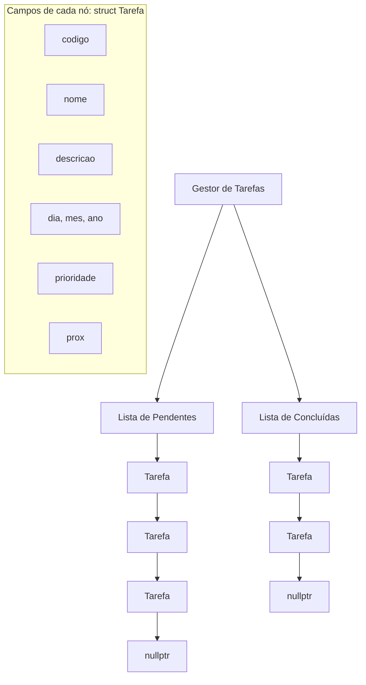

Gestor de Tarefas em C++
1. Descrição do sistema
O Gestor de Tarefas é um sistema desenvolvido na linguagem C++,
com o objetivo de auxiliar no cadastro, na organização e no
acompanhamento de atividades. Por meio de um menu interativo no
terminal, o usuário pode registrar tarefas, consultar as atividades
cadastradas, pesquisar por nome, organizar os registros por critérios
específicos, excluir tarefas e controlar sua situação.

Cada tarefa possui um código identificador, nome, descrição, data e
nível de prioridade. O sistema mantém as atividades separadas em duas
categorias: pendentes e concluídas. Também permite reabrir uma
tarefa concluída, retornando-a à lista de pendentes.

Para garantir a consistência dos registros, o programa realiza
validações de entrada e de datas. A organização das atividades utiliza
listas simplesmente encadeadas, com alocação dinâmica de memória por
meio de new e liberação por delete.

2. Tema escolhido
O tema escolhido para o projeto foi Gestor de Tarefas. A proposta é
desenvolver uma aplicação simples e funcional que facilite o
gerenciamento de atividades, permitindo acompanhar prazos, identificar
prioridades e visualizar quais tarefas ainda precisam ser realizadas.

A escolha do tema busca aplicar, em uma situação prática, os conceitos
de lógica de programação, funções, estruturas de dados, ponteiros e
gerenciamento de memória estudados na linguagem C++.

3. Estruturas de dados utilizadas
A principal estrutura utilizada é a struct Tarefa, responsável por
armazenar os dados de cada atividade:
- codigo: identificador numérico da tarefa;
- nome: título da atividade;
- descricao: informações complementares;
- dia, mes e ano: data associada à tarefa;
- prioridade: nível de prioridade definido;
- prox: ponteiro para o próximo elemento da lista.
As tarefas são armazenadas em duas listas simplesmente encadeadas:
uma para as tarefas pendentes e outra para as concluídas. Cada elemento
da lista contém os dados de uma tarefa e um ponteiro que indica o
próximo elemento. O último nó aponta para nullptr.

Diagrama da estrutura de dados

A inserção de uma tarefa ocorre ao final da lista correspondente. Para
realizar buscas, listagens, ordenações e remoções, o programa percorre e
manipula os nós por meio de ponteiros. A ordenação utiliza o algoritmo
Bubble Sort, considerando o prazo ou a prioridade. A movimentação
entre as listas permite concluir ou reabrir tarefas sem criar um novo
registro.

4. Divisão de responsabilidades entre os integrantes
O desenvolvimento foi realizado em equipe, com a distribuição das
atividades conforme as responsabilidades assumidas por cada integrante:
  Integrante                          Responsabilidades
  Murilo                          Responsável pela maior parte da
implementação do código-fonte,
contribuindo principalmente para o
desenvolvimento da lógica e das
funcionalidades do sistema.

  Guilherme                       Participação no desenvolvimento do
código-fonte e elaboração deste
arquivo README, reunindo e
documentando as informações
técnicas e organizacionais do
projeto.
Eduardo                         Responsável pela elaboração do
arquivo arquivo.txt, utilizado
como parte dos materiais entregues
junto ao projeto.
A divisão das atividades permitiu organizar o desenvolvimento e a
documentação, contribuindo para a conclusão do projeto de forma
colaborativa.